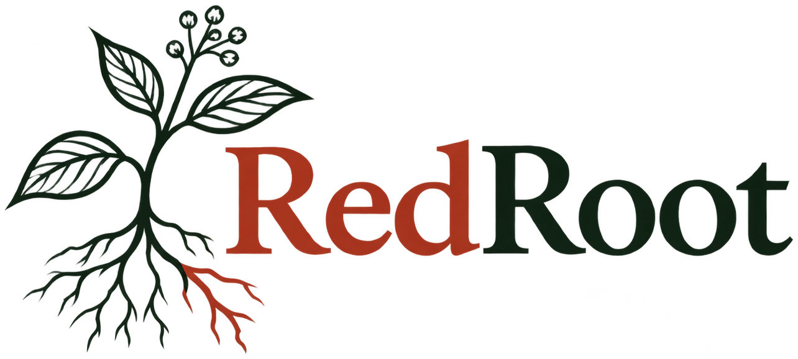
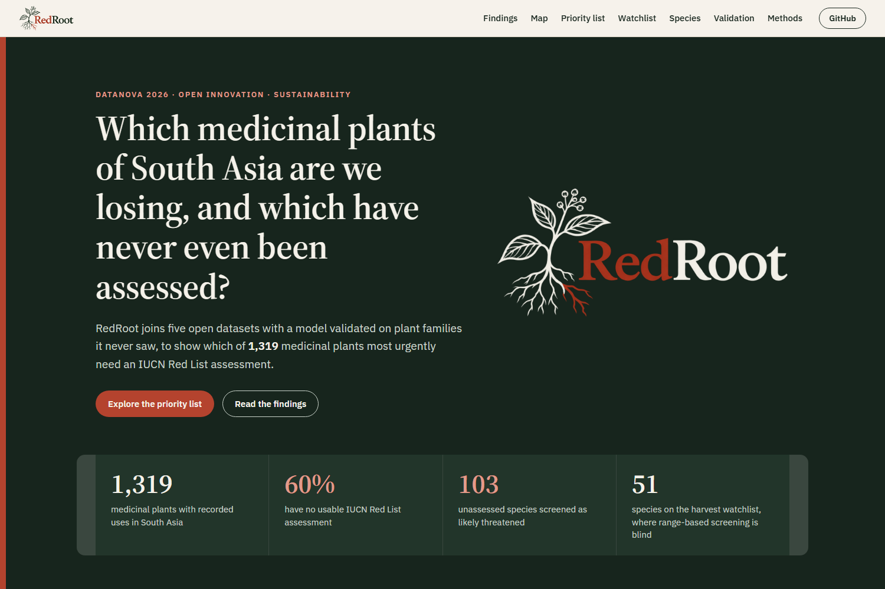
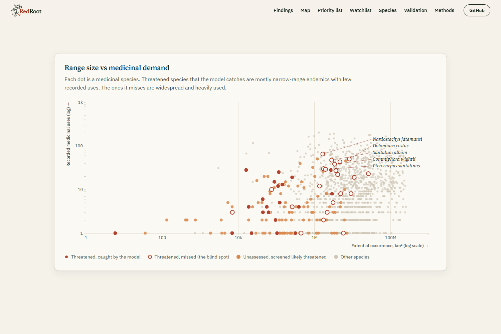
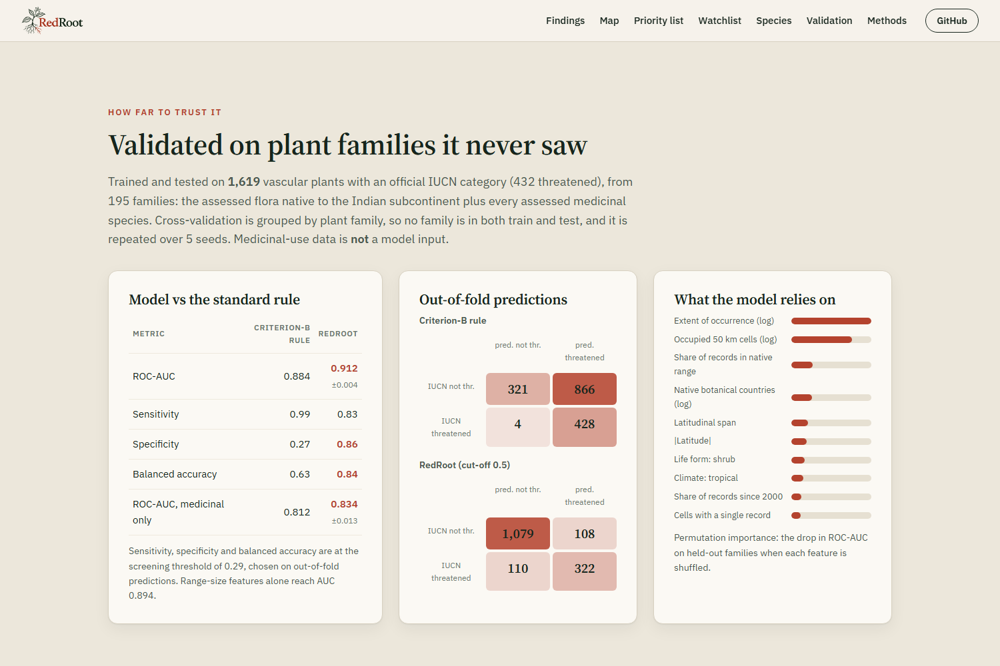
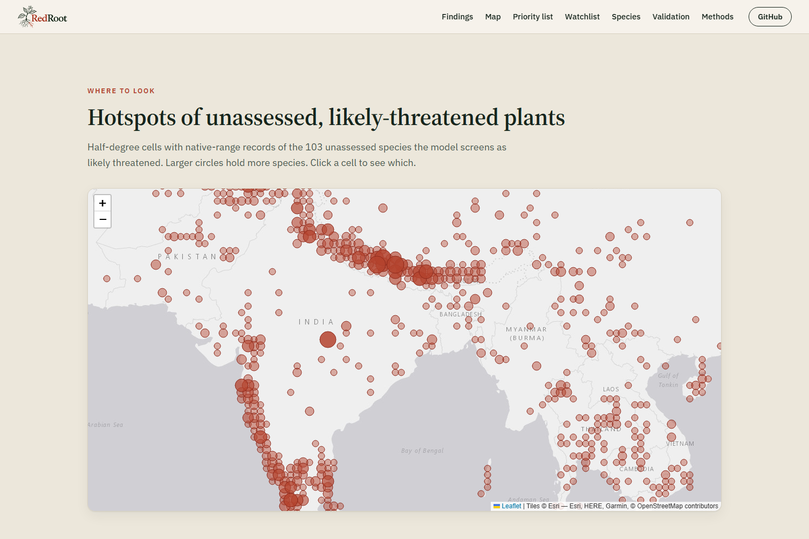
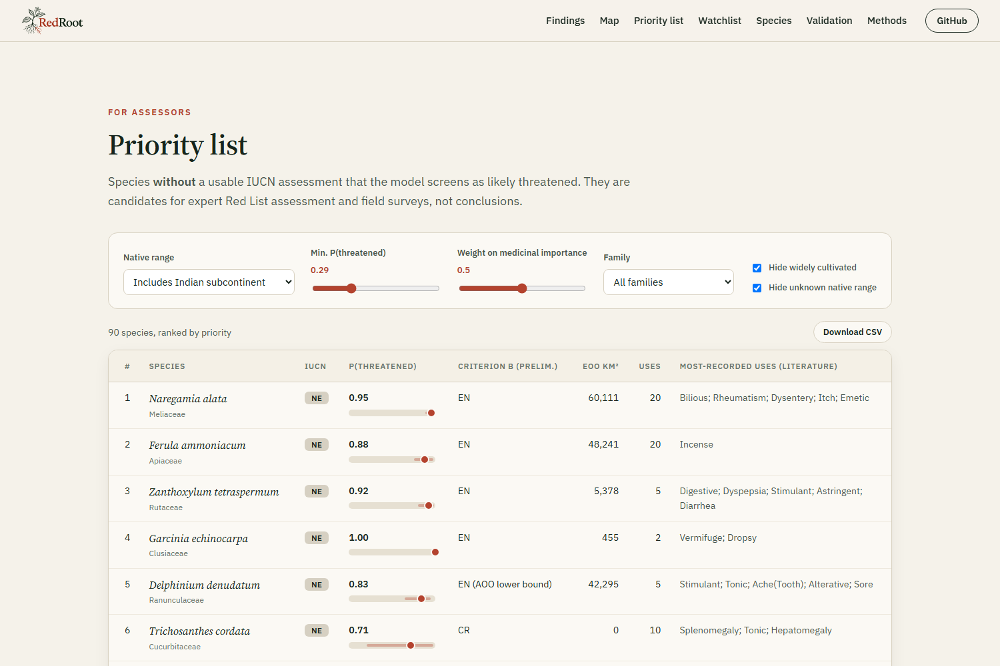
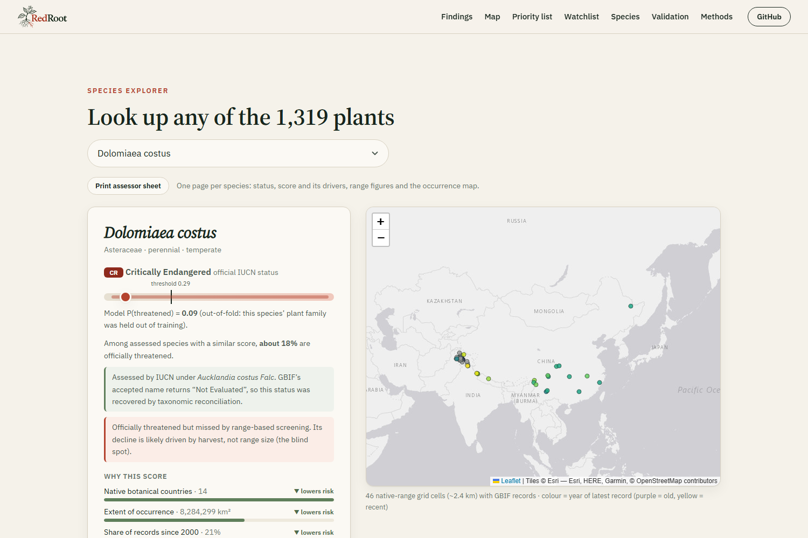
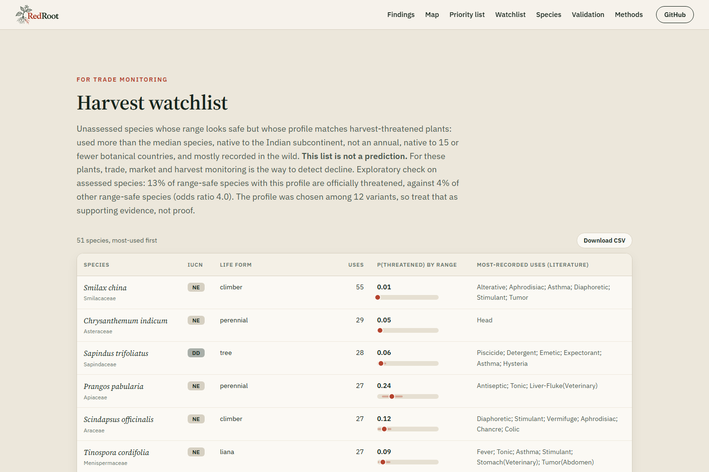

<p align="center"></p>

<h1 align="center">RedRoot: extinction-risk radar for South Asia's medicinal plants</h1>

<p align="center">
<b>DataNova 2026 Global Data-thon · Open Innovation Challenge (DN-OP-01) · Sustainability &amp; Environmental Innovation</b><br>
<a href="https://dukenukem1611.github.io/redroot/"><b>Live website</b></a> ·
<a href="docs/methods.md">Methods</a> ·
<a href="docs/dataset.md">Dataset description</a> ·
<a href="docs/devpost.md">Devpost write-up</a> ·
<a href="#reproduce-from-scratch">Reproduce</a>
</p>



> South Asian traditional medicine uses well over a thousand recorded plant species. Most of them have **never been assessed** for extinction risk. An unassessed plant is invisible to Red List-based policy, trade regulation (CITES) and conservation funding. RedRoot combines five open datasets with a machine-learning model, validated on plant families it never saw, to show **which medicinal plants most urgently need a Red List assessment and field survey**. It also shows where the standard range-based screening goes blind.

## Submission at a glance
| DataNova requirement (DN-OP-01) | Where to find it |
|---|---|
| Problem statement | [The problem](#the-problem) |
| Working demo | **https://dukenukem1611.github.io/redroot/** |
| Code | this repository, [`src/`](src) and [`docs/`](docs) |
| Documentation | this README and [docs/methods.md](docs/methods.md) |
| Dataset description | [docs/dataset.md](docs/dataset.md) |
| Results and validation | [Validation](#validation) and [`data/processed/metrics.json`](data/processed/metrics.json) |
| Impact assessment | [Who this is for and what comes next](#who-this-is-for-and-what-comes-next) |

## Contents
- [Submission at a glance](#submission-at-a-glance)
- [At a glance](#at-a-glance)
- [The problem](#the-problem)
- [What we found](#what-we-found)
- [Outputs: two lists for two kinds of risk](#outputs-two-lists-for-two-kinds-of-risk)
- [Validation](#validation)
- [How it works](#how-it-works)
- [The website](#the-website)
- [Reproduce from scratch](#reproduce-from-scratch)
- [Output files](#output-files)
- [Repository layout](#repository-layout)
- [Limitations](#limitations)
- [Responsible use](#responsible-use)
- [Who this is for and what comes next](#who-this-is-for-and-what-comes-next)
- [Data sources, licences and citations](#data-sources-licences-and-citations)

## At a glance
| | |
|---|---|
| Medicinal species analysed (South Asian records in Dr. Duke's database) | **1,319** |
| …with no usable IUCN assessment (Not Evaluated or Data Deficient) | **60%** (791 species) |
| …officially threatened (CR / EN / VU) | 46 (8 CR, 18 EN, 20 VU) |
| IUCN assessments recovered from behind GBIF synonyms | **45**, 6 of them threatened (e.g. kuth, *Dolomiaea costus*, CR) |
| Wrong synonym transfers rejected and logged | 22 (e.g. ashwagandha would have become CR) |
| Unassessed species screened as likely threatened (**priority list**) | **103** (90 native to the subcontinent, 36 endemic, 38 robust across the ensemble) |
| Unassessed, heavily used, range-safe species (**harvest watchlist**) | **51** |
| Widely cultivated species, flagged and hidden by default | 138 (e.g. black pepper, saffron) |
| Model ROC-AUC on held-out plant families | **0.912 ± 0.004** (criterion-B rule: 0.884) |
| Specificity at a sensitivity of 0.83 | **0.86** (criterion-B rule: 0.27) |
| Threatened species among the top 100 of the ranking (out-of-fold) | **97** (range-size rule: 84, random: about 27) |
| Calibration error of the reported share threatened | **0.016** (raw score: 0.052) |

## The problem
- Most of the medicinal-plant trade in India and the Himalaya is supplied by wild harvest. Species such as *Nardostachys jatamansi* (jatamansi), *Picrorhiza kurroa* (kutki) and *Dolomiaea costus* (kuth) are already threatened by overharvesting.
- The IUCN Red List is the global standard for extinction risk, but each assessment takes scarce expert time. Most plants, medicinal ones included, have never been assessed.
- **No assessment means no visibility** in conservation policy, trade regulation or funding. Assessors and agencies need to know **where to look first**.

## What we found

### Finding 1: synonyms hide threatened plants
GBIF attaches IUCN categories to the name IUCN used. When GBIF treats that name as a synonym, the accepted species shows as "Not Evaluated". Kuth, for example, is Critically Endangered as *Aucklandia* / *Saussurea costus*, but GBIF's accepted *Dolomiaea costus* returns nothing.

We checked every unassessed species against its GBIF synonyms and its Kew WCVP accepted name, and **recovered 45 assessments, 6 of them threatened**. Status is transferred only from **homotypic** synonyms, which share the epithet and so are the same taxon under a different genus. Heterotypic synonyms are different taxa to IUCN. A naive "any synonym" rule would make ashwagandha (*Withania somnifera*) Critically Endangered through *Withania chevalieri*, a Cape Verde endemic. That candidate and 21 others are rejected and logged in `data/interim/iucn_reconciled.csv`.

### Finding 2: the blind spot


Of the 43 threatened medicinal species in the validation set, range-based screening:
- **catches 21**: mostly narrow-range endemics, with a median of **4** recorded uses
- **misses 22**: widespread and heavily harvested, with a median of **15.5** recorded uses (Mann-Whitney p = 0.03). They include jatamansi, kuth, sandalwood (*Santalum album*), guggul (*Commiphora wightii*), red sanders (*Pterocarpus santalinus*) and *Paris polyphylla*.

These plants are threatened by harvest-driven decline (IUCN criterion A), which a range-based model cannot see. Use counts cannot fix this either: among range-safe species they barely separate threatened from non-threatened (AUC 0.55, 95% CI 0.42–0.67). RedRoot therefore **does not fold use into the risk score**. It reports harvest risk as a separate monitoring list and states the limitation openly.

## Outputs: two lists for two kinds of risk

### Priority list: where to send assessors
Unassessed species that the model screens as likely threatened (P ≥ 0.29, the screening threshold). They are ranked by `P × ((1 − w) + w × use percentile)`. The weight `w` is a policy choice that users can change on the website. Each species has an uncertainty band (10th–90th percentile of a 25-model ensemble).

| Species | Family | P(threatened) [P10–P90] | Recorded uses | EOO (km²) |
|---|---|---|---|---|
| *Naregamia alata* | Meliaceae | 0.95 [0.88–0.99] | 20 | 60,111 |
| *Ferula ammoniacum* | Apiaceae | 0.88 [0.75–0.97] | 20 | 48,241 |
| *Zanthoxylum tetraspermum* | Rutaceae | 0.92 [0.80–0.99] | 5 | 5,378 |
| *Garcinia echinocarpa* | Clusiaceae | 1.00 [1.00–1.00] | 2 | 455 |
| *Delphinium denudatum* | Ranunculaceae | 0.83 [0.64–0.94] | 5 | 42,295 |
| *Jasminum rottlerianum* | Oleaceae | 0.92 [0.79–0.99] | 2 | 418 |

The full, filterable list is on the website and can be downloaded as CSV.

### Harvest watchlist: where to monitor trade
Unassessed species whose range looks safe but whose profile matches the plants the model misses:
- used more than the median species
- native to the Indian subcontinent
- not an annual
- native to at most 15 botanical countries
- at least half of its records within the wild range

Among *assessed* species this profile is about **4× enriched** for threatened plants: 8 of 63 (12.7%) against 3.5% of other range-safe species (odds ratio 4.0, Fisher p = 0.005). The profile was chosen from 12 variants, so this check is **exploratory**. The watchlist is a monitoring list, not a prediction.

Examples: *Smilax china*, *Tinospora cordifolia* (giloy), *Euryale ferox* (makhana), *Scindapsus officinalis* (gajapippali), *Prangos pabularia*, *Hydnocarpus kurzii* (chaulmoogra), *Thalictrum foliolosum*.

## Validation
The model is trained on **1,619 IUCN-assessed vascular plants native to the Indian subcontinent** (432 threatened, 195 families, 512 of them medicinal). Medicinal species alone are too few (43 threatened). Threatened means CR/EN/VU, against NT/LC.

**Cross-validation is grouped by plant family**, so the model is always scored on families it never trained on. It is repeated over 5 seeds (mean ± sd):

| Metric (out-of-fold) | Criterion-B rule | RedRoot ML |
|---|---|---|
| ROC-AUC, regional flora | 0.884 | **0.912 ± 0.004** |
| Sensitivity / specificity at the screening threshold | 0.99 / 0.27 | **0.83 / 0.86** |
| Balanced accuracy at the screening threshold | 0.63 | **0.84** |
| F1 (threatened) | 0.50 | **0.74** |
| Brier score | — | 0.104 ± 0.002 |
| ROC-AUC, medicinal subset | 0.812 | **0.834 ± 0.013** |
| Sensitivity / specificity on the medicinal subset at the threshold | 0.95 / 0.36 | 0.49 / 0.94 |

- **Why it matters:** the criterion-B rule flags almost everything as threatened (866 of 1,187 non-threatened species are false alarms). At the screening threshold the model cuts that to 170 false alarms and still catches 83% of threatened species (357 of 432).
- **Ablation:** range-size features alone reach AUC 0.894 ± 0.005. Sampling-effort, geography and life-form features add the rest.
- **Medicinal subset:** sensitivity is lower here because of the blind spot described above, which is why the harvest watchlist exists.
- **Decision value:** if assessors work down a ranking of the 1,619 assessed species (out-of-fold), the top 100 by RedRoot hold **97** threatened species, against 84 for the range-size rule and about 27 at random. Finding half of the 432 threatened species takes **243** assessments, against 283 and 810. On medicinal species alone, the top 50 hold 21 threatened species, against 15 and about 4.
- **Calibration:** trained with balanced class weights, the raw score is a ranking that runs high at the top (expected calibration error 0.052). An isotonic map, checked by family-grouped cross-fitting, turns it into the observed share of threatened species among similar assessed species (error 0.016). Species cards report that share; rankings and lists are unchanged.
- **Explanations:** every species card shows the four factors that most drive its score (exact TreeSHAP values). For assessed species they come from the cross-validation models that never saw the species' family, so they match the out-of-fold score shown.
- **What the model relies on** (permutation importance on held-out families):
  1. extent of occurrence
  2. occupied 50 km cells
  3. share of records in the native range
  4. number of native botanical countries
  5. latitudinal span

<p align="center"></p>

## How it works
```
Dr. Duke's ethnobotany (CC0) ──► 1,319 medicinal species used in South Asia
        │                                     │ GBIF Backbone Taxonomy (strict match, synonyms merged)
        ▼                                     ▼
 use-pressure features          IUCN category (GBIF mirror) + homotypic synonym reconciliation ─► labels
 (ranking only, not a           GBIF occurrences (Maps API grid, ~2.4 km)
  model input)                     └─► Kew WCVP native-range filter (TDWG level 3)
                                         └─► EOO, AOO, 10/50 km cells, sampling effort, recency, life form, climate
                                                                     │
          criterion-B rule baseline ◄──────────┬──────────► gradient-boosted trees
                                               │   cross-validation grouped by family × 5 seeds
                                               ▼
                     P(threatened) + P10–P90 uncertainty for unassessed species
                                               ▼
                 priority list + harvest watchlist + flags ─► static website (docs/)
```

| Stage | Detail |
|---|---|
| **Species list** | Every plant binomial with at least one ethnobotanical record from India (including named communities), Nepal, Pakistan, Bangladesh, Sri Lanka, Bhutan or the Himalaya in Dr. Duke's database |
| **Name resolution** | Strict GBIF Backbone match (confidence ≥ 90, kingdom Plantae). 163 of the 1,560 binomials (about 10%) could not be resolved; every match and non-match is listed in `data/interim/name_matching.csv` |
| **IUCN status** | GBIF's IUCN checklist mirror, plus homotypic synonym and WCVP accepted-name reconciliation |
| **Occurrences** | GBIF Maps API vector tiles: georeferenced records without geospatial issues, with garden specimens and fossils excluded. Pulling gridded tiles is far faster than paging through individual records |
| **Native-range filter** | Each grid cell is assigned to a TDWG level-3 botanical country. Only cells in the species' WCVP native range are kept, so introduced, cultivated and naturalised records are removed. For Madagascar periwinkle, 99% of records fall outside its native range |
| **Range metrics** | EOO is the geodesic area of the convex hull. AOO is occupied cells × 4 km², a lower bound on the IUCN 2 × 2 km AOO. Occupied 10 km and 50 km cells stand in for the number of locations |
| **Baseline** | Preliminary IUCN criterion B from range alone: CR if EOO < 100 or AOO < 10 km², EN if < 5,000 / < 500, VU if < 20,000 / < 2,000. This is the logic of ConR / rCAT |
| **Model** | scikit-learn `HistGradientBoostingClassifier` (class-balanced) on 30 features: range size, geography, sampling effort and recency (to separate *rare* from *rarely recorded*), and WCVP life form and climate. **Medicinal-use data is not an input** |
| **Threshold** | 0.29, chosen to maximise sensitivity + specificity (Youden) on out-of-fold predictions |
| **Uncertainty** | A 25-member bootstrap ensemble. Species with fewer than 3 native-range cells are not scored |
| **Calibration** | Isotonic map from out-of-fold score to observed share threatened, checked by family-grouped cross-fitting |
| **Explanations** | TreeSHAP values per species, life form and climate grouped, top four shown |
| **Flags** | *Widely cultivated*: under 20% of records in the native range and at least 100 records. *Native range unknown*: no WCVP match |

Every step is documented in [docs/methods.md](docs/methods.md), which the website also renders.

## The website
A static site in `docs/`, built with HTML, CSS and JavaScript, Leaflet maps and D3 charts. It has no backend and no build step: everything is read from `docs/data/*.json`, which `src/s05_export_site.py` exports. GitHub Pages serves it at **https://dukenukem1611.github.io/redroot/**.

| Section | What you can do |
|---|---|
| **Hero** | headline numbers |
| **Findings** | the two findings and the interactive range-vs-demand chart (hover for species names) |
| **Map** | hotspots of unassessed, likely-threatened species on half-degree cells; click a cell to list its species |
| **Priority list** | filter by native region (subcontinent / endemic / any), minimum P, medicinal-importance weight and family; hide cultivated or unknown-range species; download as CSV |
| **Watchlist** | the harvest watchlist with recorded uses; download as CSV |
| **Species** | look up any of the 1,319 plants: IUCN status and where it came from, P(threatened) with uncertainty and the calibrated share threatened, the four factors that drive its score, range metrics, recorded uses, flags, and an occurrence map coloured by the year of the latest record. **Print assessor sheet** gives a one-page summary per species |
| **Validation** | metrics against the baseline, confusion matrices, feature importance, how many threatened species each ranking finds, and a calibration chart |
| **Methods** | the full method, limitations and responsible-use notes |

You can link straight to a species: `https://dukenukem1611.github.io/redroot/?species=Nardostachys%20jatamansi#explorer`

<table>
<tr>
<td></td>
<td></td>
</tr>
<tr>
<td></td>
<td></td>
</tr>
</table>

**Run it locally:**
```bash
python -m http.server 8765 -d docs   # then open http://localhost:8765
```
Open it through a server: opening `index.html` directly from disk will not load the JSON. To publish it, go to Settings → Pages in the GitHub repo, set Source to "Deploy from a branch" and choose `main`, folder `/docs`.

The gallery images in `gallery/` are 1500×1000 screenshots of the page in screenshot mode, `?shot=<section id>`, for example `?shot=explorer&species=Dolomiaea%20costus`.

## Reproduce from scratch
You need Python 3.13 (the version it was developed on; recent 3.x versions should also work) and about 1 hour, mostly spent on downloads and rate-limited API calls. Raw downloads take about 550 MB of disk space, plus the API cache.

```bash
git clone https://github.com/DukeNukem1611/redroot.git && cd redroot
python -m venv .venv && source .venv/bin/activate      # Windows: .venv\Scripts\activate
pip install -r requirements.txt

cd src
python s00_download.py           # Dr. Duke's, Kew WCVP, TDWG regions (~150 MB)
python s01_species.py            # medicinal species list + GBIF name matching
python s01b_training_species.py  # regional IUCN-assessed flora (training set)
python s02_gbif.py               # IUCN categories, GBIF facets, gridded occurrences (resumable, cached)
python s02b_iucn_synonyms.py     # recover IUCN status hidden behind synonyms (homotypic only)
python s03_features.py           # native-range filter + range metrics
python s04_model.py              # baseline, ML, cross-validation, blind-spot test, predictions
python s05_export_site.py        # JSON for the website in docs/data/
```
- Every API response is cached in `data/cache/`, so reruns are fast, deterministic and work offline. `s02_gbif.py` is resumable if it is interrupted.
- API keys are not needed: all GBIF endpoints used here are public.
- GBIF and WCVP data change over time, so a fresh run on a later date can differ slightly from the numbers above, which were computed on 5 Nov 2026.
- The processed outputs are committed, so you can run only `s04_model.py` and `s05_export_site.py`, or just open the website, without downloading anything.

## Output files
| File | Contents |
|---|---|
| `data/processed/predictions.csv` | one row per medicinal species: IUCN category and its source, range metrics, `p_threatened` with `p_threatened_lo` / `p_threatened_hi`, `p_threatened_oof` (assessed species), `p_calibrated` / `p_calibrated_oof`, `drivers` (top SHAP factors, JSON), `criterion_b_prelim`, `priority_score`, `use_pressure_pct`, and the flags `assessment_gap`, `screen_threatened`, `harvest_watchlist`, `widely_cultivated`, `native_range_unknown` |
| `data/processed/metrics.json` | every number reported here: validation, blind-spot test, watchlist enrichment check, assessment-gap statistics, decision-value curves and calibration |
| `data/processed/oof_predictions.csv` | one row per training species: out-of-fold score, cross-fitted calibrated share, label, range metrics and criterion-B flag, so every validation number can be re-checked |
| `data/processed/importance.csv` | permutation importance with standard deviation |
| `data/processed/features.csv` | the model feature table |
| `data/processed/points.csv.gz` | native-range occurrence grid cells for medicinal species |
| `data/interim/iucn_reconciled.csv` | recovered IUCN categories, how each was recovered, and rejected synonym candidates |
| `data/interim/name_matching.csv` | audit of Duke name → GBIF match |

## Repository layout
| Path | Contents |
|---|---|
| `src/common.py` | paths, the South Asia country list, and a cached, rate-limit-aware HTTP helper |
| `src/s00_download.py` … `src/s05_export_site.py` | the pipeline steps, in run order (see above) |
| `docs/` | the website (`index.html`, `css/`, `js/app.js`, `data/`, `img/`), plus `methods.md`, `dataset.md` and `devpost.md` |
| `data/interim/` | species list, name-matching audit, IUCN categories and synonym reconciliation, GBIF counts |
| `data/processed/` | model inputs and outputs (see [Output files](#output-files)) |
| `gallery/` | Devpost gallery images (1500×1000, 3:2) |
| `assets/` | logo files |

Raw downloads (`data/raw/`), the API cache (`data/cache/`) and per-species grids (`data/interim/grid/`) are not committed; the pipeline recreates them.

## Limitations
- **Screening estimates, not Red List categories.** Official listing needs expert assessment of population decline, threats and locations.
- **Label bias.** IUCN-assessed species are not a random sample: threatened and well-studied taxa are over-represented.
- **Sampling bias.** GBIF coverage of South Asia is uneven and herbarium-heavy, so under-collected species can look rarer than they are. Sampling-effort features reduce this but do not remove it.
- **Harvest-driven decline is invisible to range data.** This is the blind spot, which is why the watchlist is kept separate.
- **Use counts measure how often a plant is recorded as medicinal, not how much is harvested.** Cultivated plants such as turmeric can be heavily used without wild harvest.
- **Grid resolution.** For very widespread species GBIF tiles are coarser than 2 km, so AOO is a loose lower bound. These species are far above every threshold anyway.

Details are in [docs/methods.md](docs/methods.md#limitations-and-how-to-read-the-outputs).

## Responsible use
- RedRoot's outputs are **preliminary, screening-level estimates** for prioritising expert assessment, not official IUCN categories.
- Recorded traditional uses are shown as documented in the literature, **not as evidence of efficacy or safety**. Nothing here is medical advice.
- We use only published, openly licensed ethnobotanical records (Dr. Duke's, CC0), aggregated to counts and use categories. No preparations, dosages or community-specific knowledge are published beyond what the source cites.
- Prioritising a plant for conservation must not become a reason to restrict the customary, sustainable use rights of the communities who hold this knowledge. Their participation, under the Nagoya Protocol and India's Biological Diversity Act, is a precondition.

## Who this is for and what comes next
**Intended users:**
- Red List assessors, such as the IUCN SSC Medicinal Plant Specialist Group
- the Botanical Survey of India
- State Biodiversity Boards
- the National Medicinal Plants Board
- herbal-industry supply-chain teams that need to know which raw materials carry risk

**Next steps:**
1. Add CITES trade and market-price data so the watchlist can detect decline directly.
2. Field-check the top priority species with regional botanists.
3. Add climate-change exposure for Himalayan species.
4. Extend the pipeline to other regions; only the country list and TDWG region change.
5. Co-design the watchlist with harvesting communities.

## Data sources, licences and citations
| Dataset | Use | Licence / terms |
|---|---|---|
| [Dr. Duke's Phytochemical and Ethnobotanical Databases](https://doi.org/10.15482/USDA.ADC/1239279), USDA-ARS | medicinal-use records | CC0 1.0 |
| [GBIF Backbone Taxonomy](https://doi.org/10.15468/39omei) | name resolution | CC BY 4.0 |
| [GBIF occurrence data](https://www.gbif.org) via the Maps and Occurrence APIs | species distributions | CC0 / CC BY / CC BY-NC per dataset. Only aggregated grid counts are used; no individual records are redistributed. A citable GBIF download DOI will be added for the final version |
| [IUCN Red List](https://www.iucnredlist.org) categories, via GBIF's mirror of the IUCN checklist | training labels | IUCN Terms of Use: non-commercial research use with attribution. Categories are shown; assessments are not redistributed |
| [World Checklist of Vascular Plants](https://doi.org/10.1038/s41597-021-00997-6), RBG Kew | native ranges, life form, climate | CC BY 4.0 |
| [TDWG WGSRPD](https://github.com/tdwg/wgsrpd), level 3 | botanical-country polygons | open (TDWG) |
| Esri World Light Gray Canvas | website basemap | Esri terms of use, with attribution shown on the map |

**Citations:**
- Duke, J.A. (1992–2016). Dr. Duke's Phytochemical and Ethnobotanical Databases. USDA-ARS.
- GBIF.org (2026). GBIF Occurrence Data, accessed 5 Nov 2026.
- IUCN (2026). The IUCN Red List of Threatened Species.
- Govaerts, R. et al. (2021). The World Checklist of Vascular Plants. *Scientific Data* 8:215.
- Brummitt, R.K. (2001). World Geographical Scheme for Recording Plant Distributions, 2nd ed. TDWG.
- IUCN Standards and Petitions Committee (2024). Guidelines for Using the IUCN Red List Categories and Criteria, v16.

## Team
Built by two students at IIT Kharagpur:
- [Harshil Agarwal](https://github.com/DukeNukem1611)
- Aditi Choudhary

## Licence
Code: MIT (see [LICENSE](LICENSE)). Derived data: subject to the licences of the source datasets above.
